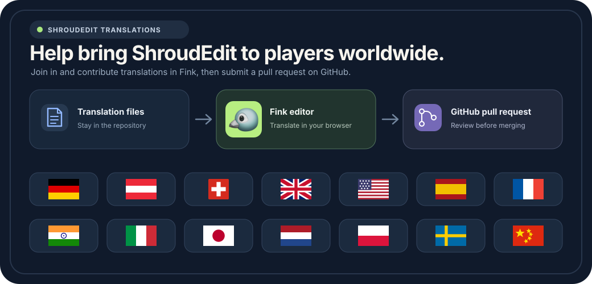

# ShroudEdit

# Shroudedit x Shroudforge Network

  <strong>🔨 <a href="https://shroudforge.net/">Check out the official download page →</a></strong>
  &nbsp;
  &nbsp;&nbsp;&nbsp;·&nbsp;&nbsp;&nbsp;
  <strong>📖 <a href="https://wiki.shroudforge.net/">Visit the official Modloader Wiki →</a></strong>
  &nbsp;

## Welcome!

ShroudEdit is a website and API for discovering and publishing Enshrouded community projects. This monorepo contains the frontend, Labrinth API, shared UI, and API client.

The ShroudEdit API accepts ShroudForge Blueprint (`.sfbp`) V7 files and stores them unchanged. The format and OAuth S256 PKCE upload flow for connected editor clients are described in the [SFBP reference](apps/labrinth/SFBP_FORMAT.md).

## Use ShroudEdit

- [Open the website](https://shroudedit.com)
- [Browse Enshrouded mods](https://shroudedit.com/discover/mods)
- [Browse World Editor blueprints](https://shroudedit.com/discover/schematics)
- [Read the documentation](https://docs.shroudedit.com)

## Local development

This repository uses pnpm workspaces and Turborepo.

1. Install the repository's pnpm version and dependencies with `pnpm install`.
2. Configure the frontend environment for the services you use locally.
3. Start the website with `pnpm web:dev`.

Read the root [AGENTS.md](AGENTS.md) and the project-level instructions before changing a project. [Frontend setup](apps/frontend/AGENTS.md) covers website development; [Labrinth setup](apps/labrinth/AGENTS.md) covers API and database requirements.

## Repository layout

| Path                  | Purpose                                           |
| --------------------- | ------------------------------------------------- |
| `apps/frontend`       | ShroudEdit website                                |
| `apps/labrinth`       | Rust API, accounts, projects, and version uploads |
| `packages/api-client` | Shared API client                                 |
| `packages/ui`         | Shared Vue components                             |
| `packages/assets`     | Shared icons, illustrations, and styles           |

## Monetization

Monetization features are disabled by default. Set `MONETIZATION_ENABLED=true` for both the website and API to enable them again. The switch keeps the implementation and existing project data available while hiding the related routes and stopping their background jobs.

## Website advertising

Website advertising uses Google Ad Manager and is configured separately from player and creator monetization. The website reads these variables at build time. Set the production values in `apps/frontend/wrangler.jsonc` under `vars` and the development values separately under `env.dev.vars`.

| Variable                           | Value                                                                                                                                |
| ---------------------------------- | ------------------------------------------------------------------------------------------------------------------------------------ |
| `ADS_ENABLED`                      | `true` to enable website advertising. Defaults to `false`.                                                                           |
| `GAM_DISCOVER_AD_UNIT_PATH`        | 300×250 unit for the Discover filter sidebar.                                                                                        |
| `GAM_PROJECT_AD_UNIT_PATH`         | 300×250 unit for the project sidebar.                                                                                                |
| `GAM_COLLECTION_AD_UNIT_PATH`      | 300×250 unit for the collection sidebar.                                                                                             |
| `GAM_USER_AD_UNIT_PATH`            | 300×250 unit for the user profile sidebar.                                                                                           |
| `GAM_ORGANIZATION_AD_UNIT_PATH`    | 300×250 unit for the organization sidebar.                                                                                           |
| `GAM_DISCOVER_MOBILE_AD_UNIT_PATH` | 320×50 unit after the sixth Discover result.                                                                                         |
| `GAM_PROJECT_MOBILE_AD_UNIT_PATH`  | 320×50 unit below the project description.                                                                                           |
| `ADS_TXT`                          | Google and any other confirmed seller entries for `/ads.txt`, separated by literal `\n` when supplied as a single Wrangler variable. |

Create all seven ad units in Google Ad Manager and copy each full path from its generated GPT tag, for example `/123456789/shroudedit_web_project_sidebar`. Enable AdSense for the units in GAM and publish a Google Privacy & Messaging configuration for the website. Publish the verified seller entries before enabling production ads. A slot with a missing path stays disabled. Use test inventory for development and verify all seven placements before enabling the production switch.

GPT does not require API credentials for display. Creator payouts currently use Aditude reports and do not import GAM or AdSense revenue.

## Contributing

Before opening a pull request, read the applicable project instructions and [contributing guide](https://docs.shroudedit.com/contributing/getting-started/). Report bugs or request features through [GitHub Issues](https://github.com/bonsaibauer/shroudedit/issues).

Help bring ShroudEdit to players worldwide by contributing translations in Fink. Submit your changes as a GitHub pull request. Read the [translation guide](docs/translations.md) for the steps.

## Security

Report security issues through the [ShroudEdit security page](https://shroudedit.com/legal/security).

## License

Apps and packages may use different licenses. Check the license file for the component you use, such as [frontend](apps/frontend/LICENSE), [Labrinth](apps/labrinth/LICENSE.txt), [API client](packages/api-client/LICENSE), [UI](packages/ui/LICENSE), or [assets](packages/assets/LICENSE).
