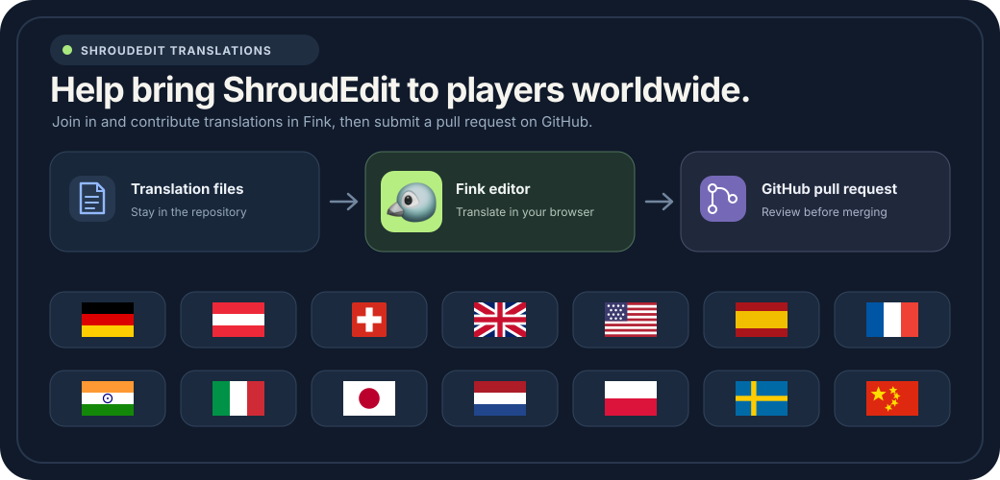

# Translate ShroudEdit

Help make ShroudEdit available to players worldwide. Edit translations in Fink or submit your changes as a pull request on GitHub.

## Translate with Fink

Open the [Fink editor for ShroudEdit](https://fink.inlang.com/?repo=bonsaibauer/shroudedit&project=project.inlang). Fink shows the English source text beside its translations. The language files stay in the repository. Fink does not keep a second synced copy in a translation service.

Choose the project and branch in the editor. Review a message, edit its translation and check the result. Fink first saves your work as a draft in your browser. You need a GitHub account to save changes to GitHub.

## Send changes as a pull request

If the default branch is protected, create a translation branch on GitHub first. Open that branch in Fink and push your changes there. Then create a pull request so the changes can be reviewed before they are merged. Fink does not create branches for you.

If you cannot write to the ShroudEdit repository, use Fink's fork flow. Install the Inlang GitHub App on your account, push the changes to your fork, then open a pull request. Fink opens GitHub's pull request page. Review and submit the pull request there.

The [ShroudEdit pull request list](https://github.com/bonsaibauer/shroudedit/pulls) shows open contributions and their review status. See the [Fink guide to branches and pull requests](https://fink.inlang.com/docs/branches-forks-and-pull-requests) for more details.

## Edit the translation files directly

You can also change the `index.json` catalogs under `apps/frontend/src/locales/{locale}/`, `packages/ui/src/locales/{locale}/` and `packages/moderation/src/locales/{locale}/`, then create a pull request in the repository. Keep the same message keys as the English source files in each `en-US` folder. Do not rename placeholders such as `{count}` or rich-text tags such as `<link>`. Preserve ICU plural and select branches so each message continues to work in the application.

Locale display names and search terms in `packages/ui/src/locales/{locale}/meta.json` are specific to each locale, so they are not part of the Fink project. Edit those values directly in a pull request when needed.

The Fink project file `project.inlang/settings.json` connects the editor to these catalogs. The link above opens that project. If you change the Fink project location, update the links in this article, the root README and the language settings in the UI.
